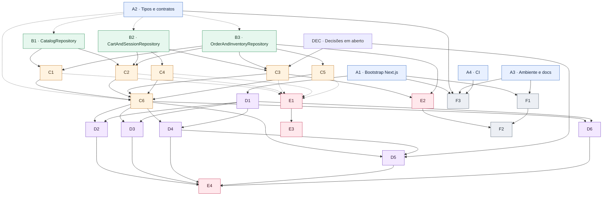

# TODO — E-Commerce com Persistência Poliglota

> Plano de trabalho derivado de [ARCHITECTURE.md](ARCHITECTURE.md). Cada item abaixo é um **pacote de trabalho independente**: pode virar um branch, um PR e ser executado por uma pessoa diferente.

## Como trabalhar em paralelo

- **Um pacote = um branch = um PR.** Nome sugerido: `feat/A2-domain-types`, `feat/B1-catalog-repository`, `fix/C3-checkout-lock-order` etc. Siga o padrão de commits do histórico (`feat:`, `fix:`, `chore:` + assunto imperativo curto).
- **Respeite a coluna "Arquivos".** Não edite arquivos de outro pacote. Se precisar de algo que não existe, deixe um comentário no PR em vez de criar o arquivo no seu branch.
- **Config compartilhada tem dono único:** `package.json`, `tsconfig.json`, `next.config.ts`, `.env.example` e `tests/persistence/environment.test.ts` são alterados **somente** pelos pacotes A1 e A3. Se precisar de uma dependência ou variável nova, descreva no PR; o maintainer aplica no pacote correto.
- **Contrato primeiro:** os pacotes B, C e D devem programar contra as assinaturas da seção [Contratos compartilhados](#contratos-compartilhados), mesmo que o pacote A2 ainda não tenha sido mergeado. Assim ninguém fica bloqueado esperando o colega.
- **Definition of done (todos os pacotes):** `npm run typecheck` e `npm test` passam sem serviços externos rodando; o comportamento novo tem teste automatizado; nenhuma string de conexão real é commitada.
- **Regra de ouro da arquitetura:** cliente nunca acessa banco; preço nunca vem do cliente; carrinho só é apagado depois do `COMMIT` no PostgreSQL.

## Já pronto (não refazer)

- [X] Clientes singleton em `globalThis` para PostgreSQL (`max: 5`), MongoDB e Redis (`lazyConnect`).
- [X] Schema PostgreSQL `init.sql` com 5 tabelas, 3 índices e trigger auditório de estoque.
- [X] Seed idempotente (`scripts/seed.ts`) via FakeStoreAPI, com validação de payload e estoque determinístico.
- [X] Suíte de persistência em `tests/persistence/` (singletons, validação, schema, env).
- [X] `docs/ARCHITECTURE.md` com o desenho completo da aplicação.

## Contratos compartilhados

Implementar/exportar exatamente estes nomes para que os branches se encaixem sem retrabalho. O dono do arquivo de tipos é o pacote **A2**; os demais apenas importam.

```ts
// src/lib/types.ts
export type ProductRecord = {
  externalId: number; title: string; price: number; description: string;
  category: string; image: string; rating: { rate: number; count: number };
};
export type Product = ProductRecord & { stock: number };
export type SuggestedProduct = Pick<Product, "externalId" | "title" | "price" | "image">;
export type CartItem = { externalId: number; quantity: number };
export type HydratedCartItem = CartItem & {
  title: string; price: number; image: string; stock: number; available: boolean;
};
export type Session = { userId: number; name: string; email: string };
export type PlacedOrderItem = {
  externalId: number; title: string; unitPrice: number; quantity: number;
};
export type OrderItem = PlacedOrderItem & { subtotal: number };
export type Order = {
  id: number; totalAmount: number; status: string; paymentMethod: string;
  deliveryAddress: string; createdAt: string; items: OrderItem[];
};

// src/lib/repositories/catalog.ts
interface CatalogRepository {
  list(category?: string): Promise<ProductRecord[]>;
  findByExternalIds(ids: number[]): Promise<ProductRecord[]>;
  findByExternalId(id: number): Promise<ProductRecord | null>;
  listCategories(): Promise<string[]>;
  suggest(query: string): Promise<SuggestedProduct[]>;
}

// src/lib/repositories/cart-session.ts
interface CartAndSessionRepository {
  getCart(userId: number): Promise<Record<number, number>>;
  addItem(userId: number, externalId: number, quantity?: number): Promise<number>;
  removeItem(userId: number, externalId: number): Promise<void>;
  clearCart(userId: number): Promise<void>;
  createSession(session: Session): Promise<string>;
  getSession(token: string): Promise<Session | null>;
  deleteSession(token: string): Promise<void>;
}

// src/lib/repositories/orders-inventory.ts
interface OrderAndInventoryRepository {
  stocksFor(ids: number[]): Promise<Map<number, number>>;
  placeOrder(input: {
    userId: number; deliveryAddress: string; paymentMethod: string; items: PlacedOrderItem[];
  }): Promise<{ orderId: number; createdAt: string }>;
  history(userId: number): Promise<Order[]>;
}
```

Repositórios devem **aceitar o cliente por injeção** (padrão com fallback para o singleton de `src/lib/db/`) para que os testes usem fakes sem rede. Cookie de sessão: nome `polyglot_session`, `HttpOnly`, `SameSite=Lax`, `Path=/`, `Max-Age=7200`. TTL do carrinho: `86400`.

---

## Épico A — Fundação da aplicação

### [X] A1. Bootstrap do Next.js 16 (App Router + Tailwind) — *concluído*

- **Arquivos:** `package.json`, `tsconfig.json`, `next.config.ts`, `postcss.config.mjs`, `app/layout.tsx`, `app/globals.css`, `app/page.tsx`.
- Adicionar de uma vez (dono exclusivo do `package.json`): `next@16`, `react`, `react-dom`, `tailwindcss`, `@tailwindcss/postcss`, `postcss`, `clsx`, `zod`, `@types/react`, `@types/react-dom`, `@playwright/test`. Nenhum outro pacote mexe nesse arquivo.
- Ajustar scripts: `dev`, `build`, `start`, `test:e2e` e ampliar `test` para `tsx --test tests/**/*.test.ts`.
- Ajustar `tsconfig.json`: `jsx: "react-jsx"`, plugin `next`, alias `@/* → ./src/*` (mantendo `strict`).
- `app/page.tsx` pode ser um placeholder temporário; `app/layout.tsx` importa `globals.css` e define `<html lang="pt-BR">`.
- **Critérios:** `npm ci && npm run typecheck && npm test && npm run build` passam; `npm run dev` sobe sem erro.

### [X] A2. Tipos e contratos de domínio — *concluído*

- **Arquivos:** `src/lib/types.ts`, `tests/persistence/types.test.ts`.
- Transcrever os tipos da seção de contratos e exportar também as interfaces dos repositórios em `src/lib/repositories/contracts.ts`.
- **Critérios:** typecheck passa; teste de compile-time ou de shape garante os campos de `Product`, `CartItem`, `Order`.

### [X] A3. Ambiente, secrets e documentação de setup — *concluído*

- **Arquivos:** `.env.example`, `tests/persistence/environment.test.ts`, `docs/ENVIRONMENT.md`.
- Documentar as 3 URLs (Supabase 5432, Atlas SRV, Upstash `rediss://`), a senha demo `123456` com salt fixo `polyglot-store-demo` (uso exclusivo de demonstração), o comando de `psql -f init.sql` e o `npm run seed`.
- Atualizar o teste de texto exato de `.env.example` junto com o arquivo (eles são acoplados).
- **Critérios:** `npm test` passa; nenhuma credencial real aparece em arquivos versionados.

### [X] A4. CI de verificação — *concluído*

- **Arquivos:** `.github/workflows/ci.yml`.
- Instalar com `npm ci`, rodar `npm run typecheck` e `npm test` em Node 20 (`.nvmrc`), sem depender de bancos externos.
- **Critérios:** workflow verde em PR; jobs falham se typecheck ou testes falharem.

---

## Épico B — Repositórios (camada de persistência)

### [X] B1. `CatalogRepository` — MongoDB — *concluído*

- **Arquivos:** `src/lib/repositories/catalog.ts`, `tests/persistence/catalog.test.ts`.
- Implementar os 5 métodos do contrato. Mapeamento `id → externalId`, mantendo **exatamente** os campos reais da FakeStoreAPI (nada de `attributes` inventados).
- `suggest`: guard clause para `trim().length < 2`, escape de metacaracteres regex, projeção leve, `limit(5)`, `$options: "i"`.
- **Critérios:** testes com fake de collection cobrem filtro por categoria, sanitização da busca, projeção e limite; typecheck passa.

### [X] B2. `CartAndSessionRepository` — Redis — *concluído*

- **Arquivos:** `src/lib/repositories/cart-session.ts`, `tests/persistence/cart-session.test.ts`.
- Carrinho como Hash (`HINCRBY`, `HDEL`, `HGETALL`, `DEL`) com `EXPIRE 86400` renovado a cada escrita. Sessão como String JSON com `SET ... EX 7200`, token via `crypto.randomUUID()`.
- `getCart` converte chaves/valores para `Record<number, number>` descartando entradas inválidas.
- **Critérios:** testes com fake de Redis provam TTL, incremento/decremento, remoção, expiração de sessão e que `clearCart` não toca em `session:*`.

### [X] B3. `OrderAndInventoryRepository` — PostgreSQL — *concluído*

- **Arquivos:** `src/lib/repositories/orders-inventory.ts`, `tests/persistence/orders-inventory.test.ts`.
- `stocksFor`: uma única query `ANY($1::int[])` devolvendo `Map` (zero N+1).
- `placeOrder` rejeita pedidos vazios e IDs de produto duplicados com `InvalidOrderError` antes de abrir uma conexão.
- `placeOrder`: `pool.connect()` → `BEGIN` → lock `SELECT quantity ... FOR UPDATE` em **ordem crescente de `externalId`** → validar saldo → `UPDATE` (trigger grava auditoria) → `INSERT orders` → `INSERT order_items` com snapshot de título/preço → `COMMIT`; qualquer falha faz `ROLLBACK` e `release()`. Nunca confiar em preço recebido.
- `history`: join `orders`/`order_items`, ordenado por `created_at DESC, oi.id ASC`, agrupado em `Order[]` na camada de serviço (pode agrupar aqui se preferir — manter um único dono da lógica).
- **Critérios:** testes com fake de client/query cobrem rollback sem debitar estoque, ordem dos locks, snapshot e agrupamento do histórico.

---

## Épico C — Regras de negócio e orquestração

### [ ] C1. `CatalogService` — composição Mongo + PostgreSQL — *depende de B1, B3 (usar contratos)*

- **Arquivos:** `src/lib/services/catalog.ts`, `tests/services/catalog.test.ts`.
- Busca no Mongo, extrai `externalId[]`, busca estoques em lote no Postgres e injeta `stock` em cada produto em `O(N)`. Reexportar `suggest` com a guard clause já aplicada no repositório.
- **Critérios:** teste prova uma única chamada de `stocksFor` com N produtos e `stock` correto em cada item.

### [ ] C2. `CartService` — hidratação do carrinho — *depende de B1, B2, B3*

- **Arquivos:** `src/lib/services/cart.ts`, `tests/services/cart.test.ts`.
- `HGETALL` → busca detalhes no Mongo (`$in`) → estoque no Postgres → itens hidratados com `available: cartQuantity <= stock`. Carrinho vazio retorna `[]` sem consultar outros bancos.
- **Critérios:** teste cobre carrinho vazio, item indisponível e item válido; nenhuma leitura de banco quando vazio.

### [ ] C3. `CheckoutService` — transação poliglota — *depende de B2, B3*

- **Arquivos:** `src/lib/services/checkout.ts`, `tests/services/checkout.test.ts`.
- Ordem obrigatória: ler carrinho → buscar preços oficiais no Mongo → ordenar por `externalId` → `placeOrder` → **somente após o commit** `clearCart`. Estoque insuficiente lança erro amigável e mantém o carrinho intacto.
- **Critérios:** testes cobrem carrinho vazio, preço do cliente ignorado, falha no estoque sem apagar carrinho, e `clearCart` chamado depois de `placeOrder`.

### [ ] C4. `AuthService` — sessão e cookie — *depende de B2*

- **Arquivos:** `src/lib/services/auth.ts`, `tests/services/auth.test.ts`.
- Login por `email` + `scryptSync` com o salt do seed; seleção rápida de usuário do seed; emissão de token e escrita do cookie `HttpOnly`; leitura e invalidação da sessão.
- **Critérios:** testes cobrem senha errada, cookie com atributos corretos, token inexistente/expirado e logout.

### [ ] C5. `OrderHistoryService` — *depende de B3*

- **Arquivos:** `src/lib/services/order-history.ts`, `tests/services/order-history.test.ts`.
- Degana `Order[]` para a UI (formatação de moeda/data opcional aqui, nunca no banco). Sem dependência do Mongo.
- **Critérios:** teste com rows duplicadas por item devolve um pedido com N itens.

### [ ] C6. Server Actions / Route Handlers (camada fina) — *depende de C1–C5*

- **Arquivos:** `src/app/actions/*.ts`, `src/app/api/session/route.ts` (se necessário).
- apenas validação com `zod`, leitura do cookie e delegação aos serviços. Retornar erros em português. Nenhuma regra de negócio aqui.
- **Critérios:** nenhuma action importa `pg`, `mongodb` ou `ioredis` diretamente; typecheck passa.

---

## Épico D — Interface (App Router)

### [ ] D1. Design system e shell da loja — *pode começar agora (após A1)*

- **Arquivos:** `app/(store)/layout.tsx`, `src/components/ui/**`, `src/lib/utils/cn.ts`.
- Tokens Tailwind, botões, inputs, cards, badges de estoque, drawer base, navbar com link para "Meus Pedidos" e logout. Sem lógica de negócio.
- **Critérios:** components renderizam isoladamente; layout não importa clients de banco.

### [ ] D2. Tela de login / seleção rápida de usuário — *depende de C4, C6, D1*

- **Arquivos:** `app/(store)/login/page.tsx`, `src/components/auth/**`.
- Formulário email+senha **e** lista de usuários do seed para entrada rápida. Redirecionar para `/` após sessão criada.
- **Critérios:** fluxo funcional sem expor `password_hash`; usuário sem sessão é redirecionado para `/login`.

### [ ] D3. Catálogo, filtros e autocomplete — *depende de C1, C6, D1*

- **Arquivos:** `app/(store)/page.tsx`, `src/components/catalog/**`.
- Vitrine com `stock`, filtro por categoria via `distinct`, busca com debounce ~300ms e até 5 sugestões; badge "sem estoque".
- **Critérios:** nenhuma sugestão para menos de 2 caracteres; nenhuma query N+1; preço vem do servidor.

### [ ] D4. Drawer do carrinho — *depende de C2, C6, D1*

- **Arquivos:** `src/components/cart/**`.
- Abrir/fechar, incrementar/decrementar com optimistic update, alerta visual quando `cartQuantity > stock`, botão para checkout.
- **Critérios:** estados vazio/carregando/erro implementados; ações passam pelas Server Actions.

### [ ] D5. Checkout — *depende de C3, C6, D4*

- **Arquivos:** `app/(store)/checkout/page.tsx`, `src/components/checkout/**`.
- Resumo com preços do servidor, endereço de entrega, forma de pagamento, botão "Finalizar pedido", mensagem clara de estoque insuficiente e redirect para "Meus Pedidos".
- **Critérios:** nenhum campo de preço editável no cliente; falha de estoque mantém o carrinho.

### [ ] D6. Meus Pedidos — *depende de C5, C6, D1*

- **Arquivos:** `app/(store)/orders/page.tsx`, `src/components/orders/**`.
- Lista de pedidos com itens (snapshot histórico), totais e data. Sem consulta ao Mongo.
- **Critérios:** pedido antigo continua correto mesmo se o catálogo mudar; estado vazio tratado.

---

## Épico E — Qualidade e verificação

### [ ] E1. Testes unitários dos serviços — *incremental, acompanha C1–C5*

- **Arquivos:** `tests/services/*.test.ts`.
- Cobertura mínima: composição de catálogo, hidratação, checkout, sessão e histórico. Usar `node:test` + `node:assert/strict` e fakes injetados, sem bancos reais.
- **Critérios:** `npm test` verde com `POSTGRES_URL`/`MONGODB_URI`/`REDIS_URL` placeholders.

### [ ] E2. Teste de concorrência do checkout — *depende de C3, B3*

- **Arquivos:** `tests/persistence/checkout-concurrency.test.ts` (ou `tests/services/`), documentação do cenário em `docs/TESTING.md`.
- Simular N compras simultâneas do mesmo SKU com estoque limitado e provar que a soma debitada nunca excede o saldo (padrão `FOR UPDATE`). Rodar localmente no WSL2 com os bancos reais; manter o teste **opcional** no CI (variável `RUN_LIVE_TESTS=1`).
- **Critérios:** zero oversell, nenhum deadlock, logs de auditoria coerentes com as movimentações.

### [ ] E3. Testes de integração com serviços reais (opt-in) — *depende de E1*

- **Arquivos:** `tests/integration/**`, `docs/TESTING.md`.
- Validar seed idempotente (rodar 2x), índices do Mongo, trigger de auditoria e fluxo completo de pedido. Tudo guardado por env flag para não quebrar o default suite.
- **Critérios:** `npm test` continua passando sem rede; com `RUN_LIVE_TESTS=1` os testes integrados passam.

### [ ] E4. E2E com Playwright — *depende de D2–D6*

- **Arquivos:** `playwright.config.ts`, `tests/e2e/**`.
- Jornadas: login rápido → buscar produto → adicionar ao carrinho → checkout → histórico; e jornada de estoque insuficiente. Usar `npm run test:e2e` (dependência já declarada no A1).
- **Critérios:** ambas as jornadas passam em `npm run dev` com dados semeados.

---

## Épico F — Deploy e entrega

### [ ] F1. Deploy na Vercel — *depende de A1, A3*

- **Arquivos:** `vercel.json` (se necessário), `docs/DEPLOY.md`.
- Configurar `POSTGRES_URL`, `MONGODB_URI`, `REDIS_URL` no painel; documentar pooler em modo session e Network Access do Atlas liberado para IPs da Vercel; manter projeto Supabase ativo antes das demo.
- **Critérios:** build e smoke test na URL pública; nenhuma credencial no repositório.

### [ ] F2. Guia de apresentação local (WSL2) — *depende de E2, F1*

- **Arquivos:** `docs/DEMO.md`.
- Passo a passo: subir `.env.local`, aplicar `init.sql`, `npm run seed`, `npm run dev`, abrir duas abas para demonstrar concorrência. Alternativa serverless documentada para tráfego baixo.
- **Critérios:** outra pessoa consegue reproduzir a demo seguindo apenas o guia.

### [ ] F3. README raiz — *depende de A1–A4*

- **Arquivos:** `README.md`.
- Visão geral, stack, links para `ARCHITECTURE.md`, `TODO.md`, `ENVIRONMENT.md`, `DEMO.md`, comandos e status do projeto.
- **Critérios:** README não duplica conteúdo dos docs; links válidos.

---

## Decisões em aberto (resolver antes dos pacotes C3/D5)

- [ ] **Endereço de entrega:** usar o endereço do usuário em `users.address` com opção de edição no checkout, ou campo livre obrigatório? Definir em `docs/ARCHITECTURE.md` e avisar quem implementa C3/D5.
- [ ] **Forma de pagamento:** aceitar qualquer string validada ou enumerar opções fixas? Hoje a coluna é `VARCHAR(30)` sem restrição, e `status` só aceita `PAGO`.
- [ ] **Seed de Mongo:** manter `upsert` (não remove produtos que saíram da API) ou passar a sincronizar remoções? Importante para a idempotência esperada.
- [ ] **Auth:** confirmar que login com senha é apenas demo (salt fixo) e que não haverá cadastro de novos usuários na UI.

## Fora de escopo

- ORM/ODM, fila de pagamento real, webhook, recuperação de senha, cadastro de usuário, internacionalização e testes de carga em CI.

---

## DAG de dependências



**Legenda**

- **Aresta sólida:** dependência real — o pacote de destino não deve ser considerado pronto antes do de origem.
- **Aresta tracejada:** dependência de contrato ou acompanhamento. O trabalho **pode começar antes** do merge (use as assinaturas da seção [Contratos compartilhados](#contratos-compartilhados)); só a integração final espera.
- **`DEC`** são as [decisões em aberto](#decisões-em-aberto-resolver-antes-dos-pacotes-c3d5): bloqueiam C3 e D5, nada mais.

**Caminho crítico:** `B2/B3 → C3/C4 → C6 → D4 → D5 → E4`. É a cadeia mais longa; priorize esses pacotes na escalação. `A1 → D1` entra em paralelo e alimenta o mesmo caminho em D4.

**Onda de execução** (linhas de uma mesma onda podem rodar em branches simultâneos):

| Onda | Pacotes                         | Observação                                                                            |
| ---- | ------------------------------- | --------------------------------------------------------------------------------------- |
| 0    | A1, A2, A3, A4, B1, B2, B3, DEC | Todo mundo começa junto; A2 e DEC são contratos/decisões, não bloqueiam as raízes. |
| 1    | C1, C2, C3, C4, C5, D1, F1      | D1 só espera A1; C* usa os contratos mesmo com B* em andamento.                        |
| 2    | C6, E1, E2, F3                  | C6 é o gargalo de integração; E1 acompanha os serviços.                             |
| 3    | D2, D3, D4, D6, E3              | Telas em paralelo, cada uma dona da sua pasta.                                          |
| 4    | D5                              | Precisa de C3, C6 e do drawer D4.                                                       |
| 5    | E4                              | Valida as jornadas completas.                                                           |
| 6    | F2                              | Guia final, após concorrência e deploy estarem provados.                              |
